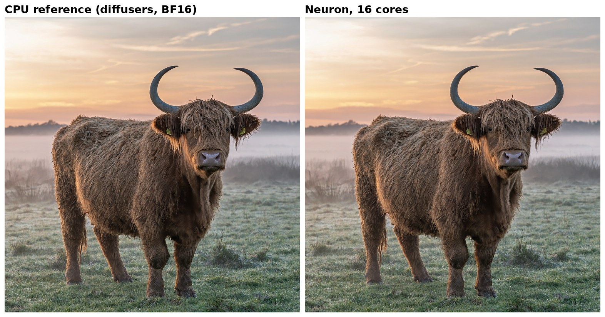

# MiniMax-H3-Image Model Card

<!-- meta: description: Model card for MiniMax-H3-Image on AWS Trainium with the
vLLM Omni Neuron plugin — supported features (text-to-image up to 4096x4096, BF16,
TP/CP parallelism, tile-parallel VAE decode), recommended 8- and 16-core
configurations, accuracy against the diffusers reference, latency, and known issues. -->
<!-- meta: keywords: MiniMax-H3-Image, MiniMax, H3, model card, text-to-image, image
generation, diffusion, DiT, PDD, step distillation, vLLM, vLLM Omni, Neuron, Trainium,
trn2, BF16, tensor parallelism, context parallelism, VAE tiling -->
<!-- meta: content_type: model-card -->
<!-- meta: date_updated: 2026-11-11 -->

## Introduction

[MiniMax-H3-Image](https://huggingface.co/MiniMaxAI/MiniMax-H3-Image) is a text-to-image and
image-editing model from the MiniMax H3 family. It generates images of up to about 16
megapixels (4096x4096) directly. Its diffusion transformer (DiT) has 33.1B parameters: 50
single-stream blocks (hidden size 5376, 56 heads of 128, SwiGLU FFN 14336) over one packed
sequence of text and image tokens with 3D rotary positions. The text encoder is the
MiniMax-H3 Qwen3-VL encoder, read at `hidden_states[50]`; the VAE has a 24-layer 2D ViT
decoder with 16x spatial compression.

The checkpoint is **guidance- and step-distilled** (Parallel Decoding Distillation): one
sample takes exactly **six DiT forwards on a fixed sigma grid**, with no classifier-free
guidance and no negative prompt. Each step has its own output head.

**Compatible model checkpoints:**

| Model | HuggingFace | Hardware | Precision |
|-------|-------------|----------|-----------|
| MiniMax-H3-Image | [MiniMaxAI/MiniMax-H3-Image](https://huggingface.co/MiniMaxAI/MiniMax-H3-Image) | Trn2 | BF16 |

The pipeline reads `transformer_diffusers/`, `vae_diffusers/`, `text_encoder/`,
`tokenizer/` and `pdd_config.json` from the checkpoint.

## Features

| Category | Feature | Status |
|---|---|---|
| **Generation** | Text-to-image | ✅ |
| | Image editing (up to 16 reference images) | ✅ |
| | 1024x1024 to 4096x4096 (`min_generation_area` canvas policy, LANCZOS resize back) | ✅ |
| | Six-step PDD sampling, no CFG | ✅ |
| **Precision** | BF16 DiT and text encoder, BF16 VAE decoder (FP32 norms) | ✅ |
| | FP8 FFN (`quantization: fp8_ffn`, W8A8 ROW) | Experimental |
| **Parallelism** | Tensor parallelism (TP=8, 7 heads per rank) | ✅ |
| | Context parallelism over the packed sequence (`ring_degree`) | ✅ |
| | Tile-parallel VAE decode over all ranks | ✅ |
| **Acceleration** | Matmul + TP reduce-scatter NKI kernels with in-kernel collectives (FGCC) | ✅ (default) |
| | Head-major attention for long sequences | ✅ (default) |
| | Static step cache (`cache_steps: [3, 5]`) | ✅ (opt-in, lossy) |
| **Compilation** | `torch.compile`, one block-group graph reused for all 50 blocks | ✅ |

### How the Neuron implementation differs from the reference

The modeling code lives in
[`vllm_omni_neuron/diffusion/models/minimax_h3_image/`](https://github.com/aws-neuron/vllm-omni-neuron/tree/main/vllm_omni_neuron/diffusion/models/minimax_h3_image).
All changes are numerically equivalent to the diffusers reference up to bf16 rounding:

- **AdaLN tables on the host.** Every block's `adaln_proj` (about 40% of the DiT
  parameters, ~26 GB) depends only on the timestep. The six timesteps are fixed, so the
  modulation rows, the output-norm modulation and the per-step output heads are computed
  once on the CPU at load time; those weights never reach the device.
- **Packed layout `[image | text | padding]`.** Unmasked self-attention is
  permutation-equivariant, so image tokens sit at fixed positions and the text is padded
  to a bucket (`text_buckets`); padded keys are masked in the attention kernel through
  its runtime `kv_used_len`, so one compiled graph serves many prompt lengths.
- **Text stream once per request.** `context_embedder` + `token_refiner` depend on the
  prompt only and run once instead of once per step.
- **Layer groups.** The 50 blocks run as ten calls of one compiled 5-block graph, with each
  group's weights passed in as graph inputs (`layers_per_graph`, default 5). This bounds
  compiler-held activations (a single 50-block graph needs ~30 GB of HBM per core at
  4096x4096 on 8 cores) and cuts cold compile time 2-3x.
- **Row-segment modulation without slicing.** Image and text rows use different AdaLN rows.
  Each row's modulation and gate are selected with `torch.where` on static row masks rather
  than by slicing the sequence into segments and concatenating it back; the copies broke
  the compiler's matmul layouts and cost ~3 ms per block (exact numerics either way).
  For the same reason the post-attention tail is no longer split into token chunks by
  default (`overlap_chunks: 1`).
- **Compiler flags.** `--internal-hlo2tensorizer-options=--hierarchy-splitter=false` is kept
  (as for Wan): without it blocks run ~8% faster, but intermediate precision changes enough
  for the six-step trajectory to drift visibly from the reference.
- **Sequence parallelism inside the TP group** (`sequence_parallel`, default on). Between
  the projections each TP rank keeps only 1/8 of its rows: the all-reduce after the output
  and down projections becomes a reduce-scatter, and an all-gather precedes QKV and the FFN
  (same bytes), so the norms, modulation, gates and residual adds run on 1/8 of the rows
  (-18% per block).
- **RoPE without slicing.** The rotate-half of RoPE is written as `x * [cos, 1] + (x @ P) *
  [sin, 0]` with `P` an exact +-1 permutation matrix, so no slice/concatenate copies are
  emitted around the attention (bit-identical). The CP all-gather of K and V is one fused
  collective instead of two. Together they removed a DMA-bound copy that dominated the edit
  graphs (single-reference edit 4.0 s -> 2.95 s on 16 cores).
- **Head-major attention for long sequences** (`HEAD_MAJOR_MIN_ROWS = 6144` rows per CP rank,
  i.e. 4096x4096 and large edits). Q/K/V are projected straight into the attention kernel's
  `[heads, S, D]` layout and the out-projection contracts over heads, so the layout transposes
  around the kernel disappear (bit-identical, -3% per block at 4096x4096; off at 2048x2048
  where the batched projections are slower).
- **Collectives inside NKI kernels (FGCC).** On Trn2 every collective the compiler emits is a
  blocking step for all engines. The out-projection and the FFN down projection therefore run
  as NKI kernels that chunk the matmul and issue each chunk's TP reduce-scatter in-kernel, so
  it overlaps the next chunk's matmuls (bit-identical; see
  [Collective overlap](#collective-overlap-fgcc-kernels)).
- **Device-resident sampling.** The latents stay on the device for all six steps: the Euler
  update is fused into the last block-group graph of each step and the host only waits on
  the step before the previous one (bounded in-flight launches, no host round trip per step).
  Text buckets are finer (`text_buckets`), so short prompts pad less.
- **Text encoder.** Only the 50 layers that feed `hidden_states[50]` are built (TP over
  the same TP group as the DiT); the token embedding lookup runs on the host.
- **VAE decode.** The reference decodes in overlapping 256-pixel tiles of identical
  shape; tiles are batched across all ranks and gathered in-graph on the device in bf16 (the
  decoder's output precision). Rank 0 copies them to the host once and stitches them by
  writing each tile's reference blend weights straight into one buffer (bit-identical to
  the reference's blend-and-concatenate stitch, 2x faster). The image is returned to the
  engine as contiguous HWC uint8, so the engine's PIL conversion no longer does a strided
  CHW -> HWC copy (-0.24 s at 4096x4096).

### Recommended configurations

| Cores | Stage config | Layout |
|---|---|---|
| 8 | [`minimax_h3_image_stage_tp8.yaml`](https://github.com/aws-neuron/vllm-omni-neuron/blob/main/examples/minimax_h3_image/minimax_h3_image_stage_tp8.yaml) | `tensor_parallel_size=8` |
| 16 (recommended) | [`minimax_h3_image_stage_tp8cp2.yaml`](https://github.com/aws-neuron/vllm-omni-neuron/blob/main/examples/minimax_h3_image/minimax_h3_image_stage_tp8cp2.yaml) | `tensor_parallel_size=8`, `ring_degree=2` |

Weights take ~11 GB of HBM per core at TP=8 (DiT ~5 GB, text encoder ~6 GB, VAE <1 GB),
so 8 cores is the minimum. A 64-core configuration
([`minimax_h3_image_stage.yaml`](https://github.com/aws-neuron/vllm-omni-neuron/blob/main/examples/minimax_h3_image/minimax_h3_image_stage.yaml),
TP=8 x CP=8) is provided but gives little over 16 cores at 1024x1024.

Run:

```bash
python examples/minimax_h3_image/run.py \
  --model-path MiniMaxAI/MiniMax-H3-Image \
  --stage-config examples/minimax_h3_image/minimax_h3_image_stage_tp8cp2.yaml \
  --height 4096 --width 4096 --min-generation-area 16777216 \
  --output out.png
```

`--min-generation-area` follows the reference: a smaller requested size is generated on a
canvas of at least this area (default 2048x2048) and resized back. Pass `1024` to generate
at the requested size.

## Examples

All images below were produced by this implementation on one Trn2 chip (16 NeuronCores,
TP8 x CP2) with the default settings (BF16, no step cache). They are JPEG-compressed copies
of the PNG outputs.

**Text-to-image, 2048x2048** (1.56 s per request), seed 42. The prompt is the checkpoint's
313-token rewritten prompt (the one the H100 benchmark uses) for the instruction

> A rustic, overhead shot of a farm-to-table feast, showcasing a variety of colorful,
> seasonal vegetables, artisanal cheeses, and freshly baked bread on a weathered wooden table.


**Text-to-image, 4096x4096** (7.09 s per request), same prompt and seed. Left: the whole image,
downscaled to 1024x1024. Right: a 1024x1024 crop at native resolution.

| Full image (downscaled) | Native-resolution crop |
| --- | --- |
|  |  |

**Neuron vs CPU reference.** Default prompt and seed at 2048x2048, against the diffusers CPU
reference that the accuracy tiers below use:



**Single-reference edit** (2.89 s per request), seed 1234, 2048 canvas. The prompt is the
checkpoint's rewritten `examples/prompt.edit.txt` (1459 presentation tokens) for the
instruction (`examples/instruction.edit.txt`)

> Take the over-ear headphones off the man on the left and fill in his hair where the band
> flattened it. Have both hosts lean toward each other and fist-bump directly above the
> "MONEY TALKS" desk sign, knuckles touching, elbows lifted off the desk, so the bump sits dead
> centre between the two microphones.


**Three-reference edit** (9.22 s per request), seed 7, 2048 canvas:

> Place the main subject of <Picture 2> into the environment of <Picture 3>, standing in the
> foreground on the left. Next to them, add the main subject of <Picture 1>. Keep the lighting
> and colour palette of <Picture 3>, photorealistic, highly detailed.


## Accuracy Evaluation

**Method.** Three tiers against the diffusers 0.42 (main) CPU reference, same prompt,
seed and initial noise:

1. **Components** — text encoder `hidden_states[50]`, one DiT step on identical inputs,
   VAE decode of identical latents.
2. **Per step** — each of the six steps fed the reference's own input latents
   (teacher-forced), comparing the predicted velocity.
3. **End to end** — PSNR of the final 8-bit image.

The six-step trajectory is very sensitive to last-bit differences (the reference scheduler
documents this), so free-running end-to-end outputs are expected to match visually, not
bit-exactly. As a calibration, the CPU bf16 reference itself differs from a CPU fp32 run by
the same per-step magnitudes as Neuron does.

| Tier | Metric | Result (Trn2) |
|---|---|---|
| Text encoder | relative L2 / per-token cosine (min) | 8.8e-4 / 0.99989 |
| DiT, per step (1024x1024, teacher-forced) | relative L2 of velocity, steps 0-5 | 0.8e-2 - 3.6e-2 (cosine >= 0.9993) |
| DiT, 2 layers | Neuron vs CPU bf16 / CPU bf16 vs CPU fp32 (step 0) | 6.0e-3 / 5.7e-3 |
| VAE decode (1024x1024) | PSNR of 8-bit image vs FP32 reference decode | 49.8 dB |

End-to-end image PSNR against the CPU reference (prompt *"A highland cow standing in a
misty meadow at sunrise, photorealistic, detailed fur"*, seed 42):

| Cores | 1024x1024 | 2048x2048 | 4096x4096 |
|---|---|---|---|
| 8 | 28.2 dB | 27.8 dB | 30.1 dB |
| 16 | 24.9 dB | 34.1 dB | 30.8 dB |

All outputs are visually indistinguishable from the reference (same composition and fine
detail at full resolution).

## Performance

trn2.48xlarge, `NEURON_LOGICAL_NC_CONFIG=2`, BF16, warm (compiled) runs, 20-token prompt,
average of three generations. "Denoise" is six DiT steps; "Request" is the wall time of
`Omni.generate`.

| Cores | Resolution | Denoise (6 steps) | VAE decode | Request | PSNR vs reference |
|---|---|---|---|---|---|
| 8 | 1024x1024 | 0.68 s | 0.05 s | **0.75 s** | 23.6 dB |
| 8 | 2048x2048 | 2.18 s | 0.21 s | **2.42 s** | 30.5 dB |
| 8 | 4096x4096 | 12.3 s | 0.81 s | **13.3 s** | 30.0 dB |
| 16 | 1024x1024 | 0.49 s | 0.03 s | **0.55 s** | 25.0 dB |
| 16 | 2048x2048 | 1.31 s | 0.14 s | **1.49 s** | 32.8 dB |
| 16 | 4096x4096 | 6.22 s | 0.49 s | **6.85 s** | 29.9 dB |

Text encoding takes 8-20 ms in every configuration. PSNR is against the diffusers CPU
reference; 23-33 dB is bf16 rounding of a six-step trajectory (no visible difference, see
[Examples](#examples)).

**Sustained load.** Back-to-back generations at 4096x4096 slow down by ~0.05 s per request
for the first ~8 requests and then level off ~5% slower (16 cores: 6.90 s for the first warm
request, ~7.25 s after ten); after 60 s idle the first request is back at 6.95 s. The same
code gives the same curve every session, so this is the device under sustained load (power /
clock), not the pipeline. Averages of three runs (this table) and medians of five (the H100
comparison below) therefore differ by up to 0.2 s at 4096x4096. Cold first requests compile for
~1-5 minutes (one compiled 5-block graph is reused for all 50 blocks).

**Where the time goes** (device profile of one warm 2048x2048 request on 8 cores, rank 0):
the device is busy 99% of the request. The DiT block groups take 95% (60 launches of
53.6 ms), the VAE decode 131 ms, the text encoder 32 ms, and host gaps between launches
33 ms in total. Inside a block (10.7 ms): the tensor engine computes for 7.6 ms (71%, about
38% of BF16 peak), TP all-reduces are exposed for 1.25 ms (12%, the rest overlaps compute),
elementwise work with the tensor engine idle takes 1.4 ms (13%) and nothing runs for 0.4 ms
(4%). The same projection matmuls chained alone in one graph run at 124 TFLOPS; most of the
gap was the segment slicing described above, which was then removed (-18% per block at this
size, -27% at 4096x4096 on 16 cores).

### Collective overlap (FGCC kernels)

On Trn2 every collective the compiler emits is a blocking step for all engines (no overlap
with independent compute). The sequence-parallel block therefore runs the out-projection and
the FFN down projection as NKI kernels that do the matmul and the TP reduce-scatter together,
chunked so that each chunk's in-kernel reduce-scatter overlaps the next chunk's matmuls
(`fgcc_kernels.py`, `mmrs_kernel`; bit-identical to the compiler path). An all-gather + matmul
kernel (`agmm_kernel`) for Q/K/V is available via `model_config.fgcc_qkv` (with head-major
attention it is slightly slower). In-kernel collectives under LNC=2 must use one `shared_hbm`
buffer per collective with each core writing its own slice, and the live (physical-mesh) TP
replica groups.

| 16 cores | 2048x2048 block | 4096x4096 block |
|---|---|---|
| compiler path | 4.50 ms | 21.10 ms |
| + head-major attention | 4.50 ms | 20.48 ms |
| + FGCC out-projection / FFN down (default) | 4.48 ms | **19.58 ms** |

End to end on 16 cores (same session, back-to-back A/B, bit-identical images): 4096x4096
request 7.07 -> 6.88 s, 2048x2048 1.58 -> 1.56 s; together with the HWC uint8 output
(-0.24 s at 4096x4096) the 4096x4096 request in the H100 comparison went from 7.31 s to
7.09 s. On 8 cores the end-to-end time is unchanged (13.89 -> 13.88 s pipeline at
4096x4096).

Tried and not kept (no gain, or slower): the all-gather + matmul kernel for Q/K/V and for the
FFN up projection with a fused SwiGLU epilogue (the in-kernel all-gather competes with the
matmuls for DMA bandwidth), an AdaLN epilogue fused into the reduce-scatter kernel, CP ring
attention (attention over the local K/V block while the partner's block is gathered
in-kernel, then an exact softmax merge), and constant-max attention (kept as an option, off
by default).

### Comparison with 2x H100

Same request as the H100 GPU benchmark (`benchmarks/minimax_h3_image_h100` on the
`minimax-h3-image-h100-gpu-benchmark` branch: official 313-token sample prompt, seed 42,
median of 5 warm runs). Neuron: `Omni.generate` wall time ("request") and the pipeline's own
time ("pipeline", the counterpart of the GPU benchmark's server-side compute; the GPU client
end-to-end additionally includes PNG + base64 + HTTP, 0.3-1.0 s).

| Case | Neuron 8 cores (pipeline / request) | Neuron 16 cores (pipeline / request) | H100x2 vLLM-Omni TP2 (server) | H100x2 SGLang Ulysses2 (server) |
|---|---|---|---|---|
| 1024x1024, native 1024 canvas | 0.84 / 0.85 s | 0.60 / 0.61 s | 0.55 s | 0.34 s |
| 1024x1024, default 2048 canvas | 2.62 / 2.63 s | 1.58 / 1.60 s | 1.37 s | 1.22 s |
| 2048x2048 | 2.58 / 2.61 s | 1.53 / 1.56 s | 1.38 s | 1.07 s |
| 4096x4096 | 13.88 / 13.99 s | 6.98 / 7.09 s | 6.12 s | 5.28 s |

4096x4096 by stage:

| Stage | Neuron 8 cores | Neuron 16 cores | H100x2 vLLM-Omni TP2 | H100x2 SGLang Ulysses2 |
|---|---|---|---|---|
| Text encoder | 11 ms | 13 ms | 68 ms | 77 ms |
| DiT, 6 steps | 13.05 s (2.17 s/step) | 6.50 s (1.08 s/step) | 5.30 s (0.88 s/step) | 4.95 s (0.83 s/step) |
| VAE decode (+8-bit, to host) | 0.82 s | 0.47 s | 0.59 s | 0.28 s |
| DiT MFU (BF16 dense peak) | 36% of 1.33 PFLOPS | 36% of 2.67 PFLOPS | ~60% of 1.98 PFLOPS | ~63% of 1.98 PFLOPS |

16 Neuron cores (4 Trainium2 chips) have ~1.35x the BF16 peak of two H100s but split the DiT
16 ways (TP8 x CP2) instead of 2. The gap is the DiT's efficiency: every collective the
compiler emits is a blocking step (all engines wait on it), so most of the 16-way
communication is exposed. With all collectives replaced by no-ops a 4096x4096 block takes
15.4 ms; the FGCC kernels hide part of it (20.5 -> 19.6 ms), the remaining ~4 ms per block
(~20%) is mostly the all-gathers before Q/K/V and the FFN and the CP K/V all-gather, which did not get faster
as in-kernel collectives. The projection matmuls reach ~57% of peak while the tensor engine
is busy.

### Single-instance throughput

For serving many requests, one trn2.48xlarge can hold several independent copies of the
pipeline. Each stage replica is a full TP=8 x CP=2 (or TP=8) pipeline with its own weights;
vllm-omni load-balances requests across them. Per-request latency is that of one replica; the
replicas start one after another (~1 minute each with a warm compile cache).

| Stage config | Layout | 2048x2048 throughput | Per-request latency |
|---|---|---|---|
| [`minimax_h3_image_stage_tp8cp2.yaml`](https://github.com/aws-neuron/vllm-omni-neuron/blob/main/examples/minimax_h3_image/minimax_h3_image_stage_tp8cp2.yaml) | 1 x 16 cores | 0.65 images/s | 1.54 s |
| [`minimax_h3_image_stage_tp8cp2_x4.yaml`](https://github.com/aws-neuron/vllm-omni-neuron/blob/main/examples/minimax_h3_image/minimax_h3_image_stage_tp8cp2_x4.yaml) | 4 x 16 cores | **2.58 images/s** | 1.54 s |
| [`minimax_h3_image_stage_tp8_x8.yaml`](https://github.com/aws-neuron/vllm-omni-neuron/blob/main/examples/minimax_h3_image/minimax_h3_image_stage_tp8_x8.yaml) | 8 x 8 cores | **3.23 images/s** | ~2.5 s |

Measured with `run.py --throughput N` (N = 16 / 32 requests submitted at once, after a warm-up
round on every replica). Eight 8-core replicas give the most images per second; four 16-core
replicas trade ~20% of that for 40% lower latency per image.

## Image editing

Requests that carry reference images (`multi_modal_data["image"]`, or `run.py --image ref.png`
repeated for `<Picture 2>`, ...) follow the reference `image_conditioned` pipeline:

- every reference is resized once for the VAE (short edge 1024-2048) and once for the vision
  tower (short edge 1024);
- the text encoder sees `Picture i: <vision block>` per reference followed by the prompt; the
  Qwen3-VL vision tower runs on Neuron (one call per image, patches padded to a 1024 bucket),
  its embeddings replace the image-pad tokens and its three deepstack features are added after
  text layers 0-2; 3D MRoPE positions come from the reference `get_rope_index`;
- the references are VAE-encoded on Neuron (the single-frame causal 3D convolutions are
  exactly 2D convolutions; 256-pixel tiles spread over all ranks), sampled from the posterior,
  noised to `t = 0.999` and held at that level for every step;
- in the DiT the per-row AdaLN table and a row permutation are runtime inputs, so one compiled
  graph serves every reference/prompt layout of a (canvas, reference bucket, text bucket).

Example from the checkpoint (`examples/reference1.png`, `examples/prompt.edit.txt`, seed 1234,
2048x2048 canvas, 1459 presentation tokens):

| Cores | Request | Host + vision + VAE encode + text encoder | Denoise (6 steps) | VAE decode | PSNR vs reference |
|---|---|---|---|---|---|
| 8 | **4.56 s** | 0.63 s | 3.69 s | 0.20 s | 33.5 dB |
| 16 | **2.89 s** | 0.54 s | 2.16 s | 0.14 s | 36.0 dB |

Three references with different aspect ratios (1536x1024, 1024x1536, 3000x1687 VAE copies;
4977 presentation tokens, 20480 packed rows on Neuron), seed 7, 2048x2048 canvas:

| Cores | Request | Host + vision + VAE encode + text encoder | Denoise (6 steps) | VAE decode |
|---|---|---|---|---|
| 8 | **17.0 s** | 3.3 s | 13.5 s | 0.21 s |
| 16 | **9.2 s** | 2.0 s | 7.0 s | 0.14 s |

The edit latency fell from 4.33 s / 12.6 s (16 cores) mostly through the slicing-free RoPE
and fused K/V gather (the edit graphs were DMA-bound on those copies), the per-reference
vision tower on its own rank with one device all-reduce to assemble the presentation, and
host threads for the preparation.

Teacher-forced target velocity against the CPU reference stays at rel 1.2-4.5e-2 (cosine
>= 0.9990) at every step. The free-running images show the same edit (same subjects, scene and
lighting) with small pose/layout differences, so their PSNR against the reference is low
(~16 dB); with ~5k vision tokens the trajectory is more sensitive than in the single-reference
case.

Accuracy per component against the CPU reference: text-row embeddings mean cosine 0.9996
(vision rows 0.993, the same spread the CPU reference shows against itself across thread
counts), reference VAE encode rel 3e-7, teacher-forced target velocity rel 1.1-2.2e-2.

## Step cache

The model samples only six steps, so a dynamic Cache-DiT policy has almost nothing to decide;
a static schedule is used instead. With `model_config.cache_steps: [3, 5]` (or
`run.py --cache-steps 3,5`), steps 3 and 5 skip the middle block groups (blocks 5-44, set
with `cache_block_groups`, default all but the first and last group) and re-apply the
residual those blocks added on the previous computed step. The first and last five blocks
always run. That removes ~27% of the DiT work.

Quality was chosen on the CPU reference (2048x2048, PSNR against the uncached reference):
steps 3 and 5 give 30.8 dB (no visible change), adding step 2 drops to 24.2 dB, and a
windowed sparse attention with similar savings drops to 22.9-28.2 dB with visible background
changes, so sparse attention is not offered.

Warm request latency on Trn2, without / with `cache_steps: [3, 5]` (PSNR against the CPU
reference in parentheses):

| Cores | 1024x1024 | 2048x2048 | 4096x4096 |
|---|---|---|---|
| 8 | 1.11 s (28.2 dB) / **0.84 s** (26.3 dB) | 3.64 s (27.8 dB) / **2.77 s** (26.2 dB) | 16.2 s (30.1 dB) / **12.3 s** (26.8 dB) |
| 16 | 0.70 s (24.9 dB) / **0.55 s** (23.7 dB) | 2.22 s (34.1 dB) / **1.73 s** (29.3 dB) | 11.0 s (30.8 dB) / **8.35 s** (27.1 dB) |

The cached images are visually close to the uncached ones, but PSNR against the reference
drops by 1-5 dB, so the cache is **not recommended** when fidelity matters and is off by
default. (These numbers predate the row-segment modulation change in the performance table
above; the relative saving is the same.)

## Quantization (experimental)

`model_config.quantization: fp8_ffn` (or `run.py --quantization fp8_ffn`) runs every DiT
block's SwiGLU FFN as FP8 W8A8 through the nkilib MLP kernel's Trn2 `ROW` mode: weights are
quantized per output column at load time (e4m3, range +-240), activations per row in the
graph. The kernel itself is 2.1x faster than the BF16 FFN (190 vs 90 TFLOPS at 4352 tokens),
but the activation quantization still runs as separate ops, so the end-to-end gain is small
and image quality drops by ~3 dB PSNR against the reference. It is not the default.

| Config | BF16 | FP8 FFN | FP8 PSNR vs reference |
|---|---|---|---|
| 16 cores, 2048x2048 | 2.23 s | 2.33 s | 27.3 dB |
| 16 cores, 4096x4096 | 11.0 s | 10.9 s | 27.5 dB |
| 8 cores, 4096x4096 | 16.2 s | 15.1 s | 27.1 dB |
| 8 cores, 2048x2048 | 3.99 s | 11.9 s (known slow path) | 25.6 dB |

Teacher-forced per-step velocity error with FP8 FFN is 2.8e-2 - 6.4e-2 relative (cosine >=
0.998), about 2-3x the BF16 error.

## Known issues and limitations

- **Edit buckets.** Reference rows are padded to multiples of 1024 and edit presentations
  to 2048/4096/8192/16384 tokens; a new bucket compiles new graphs on first use.
- **Concurrent requests run serially.**
- **One compiled graph set per (canvas, text bucket).** The first request at a new
  resolution or a prompt longer than the current text bucket compiles new graphs.
- **`NEURON_RT_XU_COMPUTE_MAX_QUEUED_REQUESTS`.** One step enqueues ~12 graph launches;
  the example runner raises the per-core queue to 63 (the runtime maximum) through the
  `MINIMAX_H3_IMAGE` environment profile. Without it, execution fails with
  `Execution Queue Full`.
- **Prompt expansion.** The optional MiniMax-H3-Image-PE prompt expander is not part of
  this pipeline; pass already expanded prompts.
